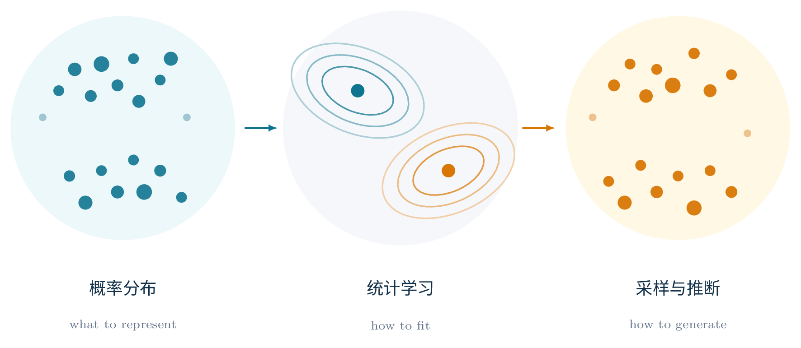

<div align="center">



# Free Energy to LLMs

### 生成模型与概率统计：从变分自由能到大模型的推理和训练

[](https://github.com/refraction-ray/free-energy-to-llms/releases/latest)
[](https://github.com/refraction-ray/free-energy-to-llms/actions/workflows/build.yml)
[](LICENSE)

中文 | [English](README.en.md)

</div>

---

一本从数学推导一路写到工程实现的生成模型教材，以统计物理和概率的视角贯穿始终。

生成模型和大模型牵涉的知识，分散在几个专业各自的课程里：

- 学数学和统计的同学熟悉概率论、KL 散度、变分法和随机微分方程，但很少看到这些工具怎样落到一个真实训练的大模型上：GRPO 在估计哪一个梯度，Flow Matching 回归的是哪条路径上的速度场，MLA 为什么能把 K/V 压进一份低维缓存。
- 学物理的同学熟悉玻尔兹曼分布、自由能、Langevin 动力学和重整化群，却未必知道它们在机器学习里都有直接的对应：变分推断最小化的正是自由能，能量模型就是玻尔兹曼分布，扩散模型的采样就是 Langevin 动力学，Born machine 把概率写进量子态的振幅。
- 学计算机的同学和做大模型的工程师熟悉 Transformer、训练流水线和推理框架，清楚 KV cache、显存带宽和并行策略的分量，却少有机会从概率出发推一遍：这些模型到底在拟合什么分布，目标函数从哪里来，为什么采样要这样做。

这本书把这几部分接在同一条线索上。讨论每个模型时都回答四个问题：它表示什么分布，用什么目标学习，怎样采样，真正的瓶颈在哪里。沿着这条线，全书从 VAE、Flow、GAN、扩散和能量模型讲到 Transformer、多模态和强化学习后训练，再讲到训练系统、推理系统、智能体系统，以及 DeepSeek 与 Kimi 的模型架构创新，最后回到生成模型在科学计算中的用例。

- 约 150 页，11 章正文加 2 个附录
- 34 幅自绘矢量插图，全部用 TikZ 写成，源码随书开放
- 134 篇参考文献，覆盖经典论文与 2025–2026 年的技术报告

## 内容

| 章 | 主题 | 主要内容 |
|---|---|---|
| 1 | 从函数拟合到概率分布 | 判别、生成与逆向设计；贝叶斯条件化；KL 的方向；最大似然与变分自由能 |
| 2 | 主流生成模型：表达、训练与采样 | 自回归、VAE、Normalizing Flow、GAN、MMD、Born machine、能量模型与 MCMC、score matching、扩散与 Flow Matching |
| 3 | Transformer | token 与嵌入、Q/K/V、因果掩码、注意力变体、归一化、FFN、MoE |
| 4 | 多模态：理解与生成 | 视觉 token 预算、CLIP 对比学习与互信息、VLM 连接器、条件注入、统一多模态模型 |
| 5 | 训练方法：从预训练到可验证奖励 | 预训练、SFT、LoRA、PPO、DPO、GRPO、可验证奖励 |
| 6 | 训练系统 | AdamW 与 Muon、QK-Norm、混合精度、训练显存账本、数据/张量/专家并行 |
| 7 | 推理系统 | prefill 与 decode、KV cache 体积估算、FlashAttention、投机解码、PD 分离与服务指标 |
| 8 | 智能体系统 | 主循环与工具调用、上下文缓存的成本、skill 与 memory、agentic search、子智能体、pass@k |
| 9 | DeepSeek 与 Kimi 架构案例 | MLA、DSA、mHC、CSA/HCA、KDA、AttnRes、Stable LatentMoE |
| 10 | 统计学习与数据模式：常见陷阱 | 模式覆盖、FID、Precision/Recall、perplexity、分布外泛化 |
| 11 | 把生成模型放回科学计算 | 有限温采样与变分自回归网络、流模型与神经网络重整化群、分子与晶体结构生成、量子线路搜索、量子态与张量网络生成 |
| 附录 | 阅读索引；公式速查与符号表 | |

## 获取与编译

正式版本的 PDF 在 [Releases](https://github.com/refraction-ray/free-energy-to-llms/releases/latest) 页面下载，每次打版本 tag 时由 GitHub Actions 从源码重新编译并发布。仓库里也随源码保存了编译好的 PDF，可以在 GitHub 上直接打开：全书是 [`book/free-energy-to-llms.pdf`](book/free-energy-to-llms.pdf)，每幅插图的 PDF 与它的 TikZ 源码并排放在 [`figures/`](figures/) 里。

从源码编译需要 TeX Live（XeLaTeX、Biber）和开源字体 Noto Sans CJK SC（与思源黑体同源）：

```bash
# macOS
brew install --cask font-noto-sans-cjk-sc
# Ubuntu / Debian
sudo apt install fonts-noto-cjk

make            # 插图和全书 → figures/*.pdf, book/free-energy-to-llms.pdf
make figures    # 只编译插图
make slides     # 最新一次开课的幻灯片 → slides/<offering>/*.pdf
make clean      # 删除中间文件目录 build/
```

仓库结构：`book/` 是正文（`main.tex`、按章拆分的源文件、`references.bib`），`figures/` 是每幅插图的 standalone TikZ 源码、编译出的 PDF 和共用样式 `figstyle.sty`，`slides/` 是配套的课堂幻灯片，每次开课一个目录，见 [`slides/README.md`](slides/README.md)。

## 作者

张士欣，中国科学院物理研究所特聘研究员、博士生导师，研究量子计算、量子多体物理以及机器学习在其中的应用。开源量子软件平台 [TensorCircuit-NG](https://github.com/tensorcircuit/tensorcircuit-ng) 的创建者和维护者。

[个人网站](https://re-ra.xyz/) · [研究组主页](https://sxzgroup.github.io/) · [物理所主页](https://iop.cas.cn/rcjy/tpyjy/?id=6789) · [Google Scholar](https://scholar.google.com/citations?user=Ut8nVqIAAAAJ) · [GitHub](https://github.com/refraction-ray)

## 勘误与反馈

发现错误或有改进建议，欢迎在 [Issues](https://github.com/refraction-ray/free-energy-to-llms/issues) 中提出，注明 PDF 版本和页码；也欢迎直接提交 Pull Request 修改 `book/` 下的源文件。

## 引用

```bibtex
@misc{zhang2026freeenergy,
  author       = {Zhang, Shi-Xin},
  title        = {Free Energy to {LLMs}: 生成模型与概率统计——从变分自由能到大模型的推理和训练},
  year         = {2026},
  howpublished = {\url{https://github.com/refraction-ray/free-energy-to-llms}}
}
```

## 许可协议

本书的文字、插图、配套幻灯片及其源码采用 [CC BY-NC-SA 4.0](LICENSE) 协议：可以在注明出处的前提下自由复制、修改和再分发，但不得用于商业目的，衍生作品须以相同协议发布。
